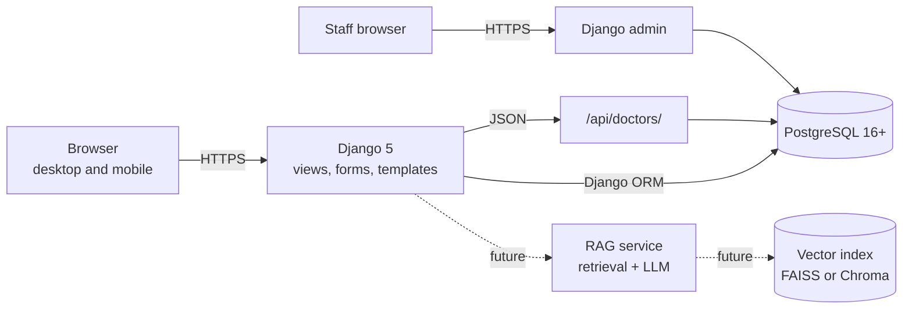
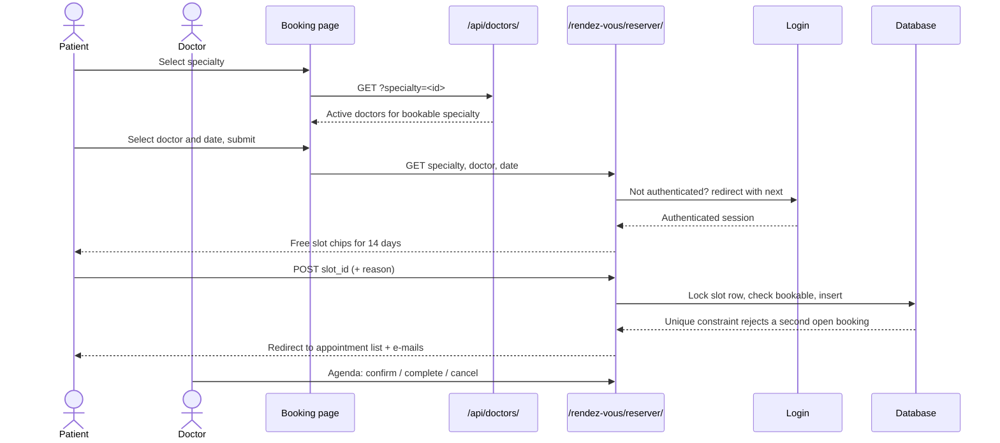
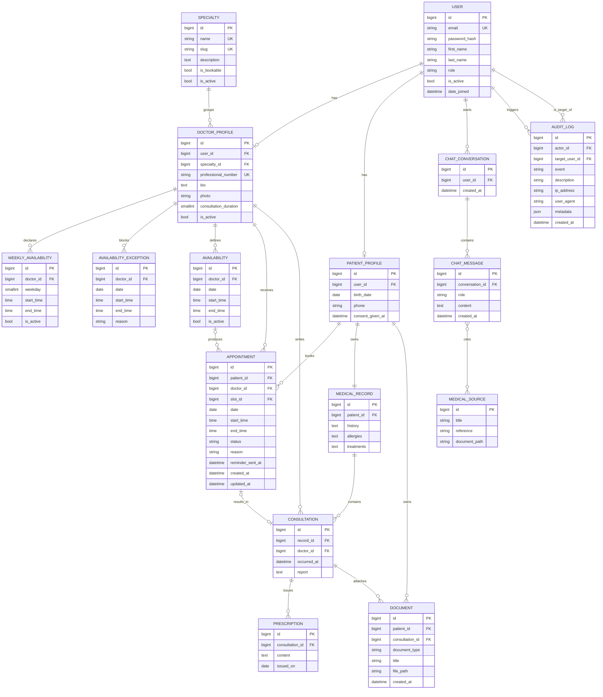

# Architecture

SmartMed AI is a server-rendered Django application. Templates produce the French public
site; server-side views enforce access rules; PostgreSQL is the single source of truth. The AI
assistant will be added behind a service boundary in Sprint 5, not embedded in page templates.

## Runtime view

Static assets are served by WhiteNoise, including locally vendored Bootstrap, Bootstrap Icons,
Inter, and project photography. No CDN is required, so the demo works offline.

## Settings

| Module              | Purpose                                                                 |
| ------------------- | ----------------------------------------------------------------------- |
| `config/settings/base.py` | Shared apps, middleware, templates, database, auth, i18n, static files |
| `config/settings/dev.py`  | `DEBUG=True`, local hosts, console e-mail                              |
| `config/settings/prod.py` | HTTPS redirect, HSTS, secure cookies, WhiteNoise compressed storage, SMTP |

`django-environ` reads `.env`; `DATABASE_URL` and `SECRET_KEY` have no committed defaults.
`manage.py` and `wsgi.py` select `dev` and `prod` respectively.

## Application boundaries

| App               | Responsibility                                                       | State          |
| ----------------- | -------------------------------------------------------------------- | -------------- |
| `accounts`        | Custom user, roles, registration, e-mail login, reset, dashboards, audit | Implemented |
| `doctors`         | Specialties, doctor profiles, weekly hours, exceptions, generated slots, public directory | Implemented |
| `patients`        | Patient profile (birth date, phone, consent)                         | Implemented    |
| `appointments`    | Appointment lifecycle: booking, cancellation, reminders, agenda       | Booking + lifecycle |
| `medical_records` | Consultations, prescriptions, documents, access control, audit        | Full module    |
| `chatbot`         | RAG conversations, messages, citations, safety rules                  | Placeholder    |
| `analytics`       | Privacy-safe dashboards and indicators                                | Placeholder    |

## Authentication and roles

`accounts.User` extends `AbstractUser` with `username = None` and `email` as
`USERNAME_FIELD`. A custom manager creates users by e-mail. Roles are stored on the user:

- `admin` — platform supervision, account and specialty management.
- `doctor` — availability, authorised patient records, reports and prescriptions.
- `patient` — own profile, bookings, own record, AI assistant.

Sprint 1 delivers the full identity layer:

- **Registration** (`/compte/inscription/`) is patient-only. The form requires first name,
  last name, e-mail, birth date, phone, and privacy consent, applies Django's password
  validators, and creates the `PatientProfile` in the same transaction. Doctor accounts are
  created by an admin at `/admin-panel/medecins/nouveau/`; there is no doctor self-registration.
- **Login** (`/compte/connexion/`) uses the e-mail address and redirects to `/patient/`,
  `/doctor/`, or `/admin-panel/` by role, unless a safe `next` URL is present. Logout is POST
  only.
- **Brute-force protection** uses `django-axes`: five failures lock the account or the client
  IP for 15 minutes, with a themed 429 response and `Retry-After: 900`. Because the user model
  authenticates on `email`, `AXES_USERNAME_FORM_FIELD` is set to `username`, the key Django's
  authentication form actually posts.
- **Password reset** sends a tokenised e-mail (console backend in development) and never
  reveals whether an address exists.
- **Role guards** are reusable mixins and decorators (`RoleRequiredMixin`, `role_required`,
  `PatientRequiredMixin`, `DoctorRequiredMixin`, `AdminRequiredMixin`). Unauthorised roles
  receive the themed 403 page; anonymous users are redirected to login with `next`.
- **AuditLog** is append-only (`save` and `delete` raise). It records login success/failure,
  lockout, logout, password reset request/completion, password change, role change, and doctor
  account creation, with actor, target, IP address, user agent, and a JSON metadata field.
  Passwords and tokens are never stored.

## Booking flow

The JSON endpoint filters on active/bookable specialty, active doctor, and active user account.
The booking entry re-validates every identifier and date server-side; it never trusts the
query string. Booking locks the slot row with `select_for_update`, re-checks that the slot is
free, and relies on the partial unique constraint as the final double-booking backstop.
Cancellations are accepted up to 2 hours before the start; rescheduling books a new slot and
silently cancels the old one in one transaction.

## Doctors, schedules, and slots

Sprint 2 separates what a doctor declares from what a patient can book:

- `WeeklyAvailability` is a recurring interval per weekday (for example Tuesday 09:00–12:00).
  Intervals for the same doctor and day cannot overlap; this is checked in
  `WeeklyAvailability.clean()`, in the management formset, and by saving through `clean()`.
- `AvailabilityException` blocks a date, either for the whole day or for a time range
  (holidays, training). It never creates slots, it only removes them.
- `Availability` is a persisted, bookable slot. Slots are generated from weekly hours in
  `consultation_duration` steps, skipping exceptions, past times, and existing rows. The
  database enforces one row per doctor/date/start time.
- `doctors/services.py` owns the engine: `generate_availability()` for a 30-day horizon,
  `rebuild_availability()` after a schedule change, and `upcoming_slots()` for the public
  profile (14 days, grouped by date). Generation is idempotent and uses
  `bulk_create(ignore_conflicts=True)`.
- Changing weekly hours or exceptions rebuilds future slots for that doctor only. Deactivating
  a doctor removes their future slots, hides them from the directory and API, disables the user
  account, and keeps all history. Reactivation regenerates the horizon.

Only active specialties, active doctors, and active user accounts appear publicly. The
directory paginates nine cards, filters by name and specialty, and uses `select_related` to
avoid per-card queries.

## Data model (target ER)

Entities marked in the table below as *planned* are part of the cahier des charges and will
be introduced progressively. Sprints 1–4 implement `USER`, `SPECIALTY`, `DOCTOR_PROFILE`,
`PATIENT_PROFILE`, `WEEKLY_AVAILABILITY`, `AVAILABILITY_EXCEPTION`, `AVAILABILITY`,
`APPOINTMENT`, `MEDICAL_RECORD`, `CONSULTATION`, `PRESCRIPTION`, `DOCUMENT`, and `AUDIT_LOG`.

| Entity             | App               | Status  |
| ------------------ | ----------------- | ------- |
| `User`             | `accounts`        | Implemented |
| `Specialty`        | `doctors`         | Implemented |
| `DoctorProfile`    | `doctors`         | Implemented |
| `PatientProfile`   | `patients`        | Implemented |
| `WeeklyAvailability` | `doctors`       | Implemented |
| `AvailabilityException` | `doctors`    | Implemented |
| `Availability`     | `doctors`         | Implemented |
| `Appointment`      | `appointments`    | Implemented |
| `MedicalRecord`    | `medical_records` | Implemented |
| `Consultation`     | `medical_records` | Implemented |
| `Prescription`     | `medical_records` | Implemented |
| `Document`         | `medical_records` | Implemented |
| `ChatConversation` | `chatbot`         | Planned |
| `ChatMessage`      | `chatbot`         | Planned |
| `MedicalSource`    | `chatbot`         | Planned |
| `AuditLog`         | `accounts`        | Implemented |

Key integrity rules to implement with foreign keys, unique constraints, and database-level
checks:

- One doctor profile per user; one patient profile per user; one medical record per patient.
- Weekly availability intervals for the same doctor and weekday cannot overlap, and every
  interval must start before it ends.
- An exception blocks either a whole day or one valid time range, never a mix.
- A slot is unique per doctor, date, and start time, and must end after it starts.
- At most one non-cancelled appointment may reference a slot (partial unique constraint);
  booking also locks the slot row (`select_for_update`) so two concurrent bookings cannot
  both pass the availability check.
- An appointment copies date and times from its slot at booking time, so history survives
  slot regeneration; `slot` is nullable and `SET_NULL`, never a cascade.
- A doctor cannot receive two appointments at the same instant, and a patient cannot book two
  appointments at the same instant.
- An appointment status is one of `pending`, `confirmed`, `completed`, `cancelled`.
- A consultation belongs to exactly one record and is written by a doctor; a prescription
  belongs to exactly one consultation and is signed only by the consultation's author.
- A document belongs to one patient, may reference one consultation, and passes an
  extension whitelist (PDF/JPG/PNG) and a 5 MB size cap before storage.
- Deleting a user or specialty must not silently destroy medical history; prefer protection
  and deactivation over cascades for clinical records.

## Security and privacy controls

- Access control is server-side and object-level; patients and doctors are scoped to their own
  data.
- Authentication is throttled by `django-axes` (five failures, 15-minute lockout). The lockout
  response is a themed 429 and never confirms whether an account exists.
- Medical documents are validated (extension whitelist, 5 MB cap) before storage and are
  served only through permission-checked, audited download views.
- Authentication events, password changes, doctor account creation, role changes, doctor
  updates, doctor and specialty status changes, availability changes, appointment bookings,
  confirmations, completions, cancellations, reschedules, and patient status changes are
  written to the append-only `AuditLog`. Medical-record access events arrive with Epic D.
- Passwords use Django's validators; production forces HTTPS, HSTS, secure cookies, and
  `X-Frame-Options: DENY`.
- The future assistant retrieves from approved sources, cites them, leaves a permanent
  disclaimer, refuses diagnosis/prescription, and redirects urgent cases to emergency services.
- All demo data is fictional and uses reserved `.test` addresses.

## Interface and accessibility

The design system lives in `static/css/base.css`, `static/css/home.css`, and
`static/css/account.css` (auth pages and dashboard shell), with CSS variables
for the teal palette, surfaces, radii, shadows, and typography (Inter). Components are
glassmorphism cards, pill buttons, and a floating navigation bar. Accessibility measures
include a skip link, visible focus states, labelled form fields, `aria-live` status messages,
keyboard-operable navigation, reduced-motion support, and contrast-checked colour variants.
The layout is verified at desktop and 390 px.

## Key decisions

1. **E-mail login now.** Changing `USERNAME_FIELD` after data exists is costly, so the custom
   user is complete in the first migration.
2. **`doctors` owns specialties and doctor profiles.** The public site and bookings both depend
   on these; patient profiles can arrive later without blocking the landing page.
3. **Emergency department is a non-bookable specialty.** It appears in the departments grid
   but is excluded from the booking select and doctor API.
4. **Booking collects intent, not a confirmed slot.** Sprint 0 preserves the selection through
   login; slot validation and persistence are intentionally deferred.
5. **Vendored front-end dependencies.** Bootstrap, icons, font, and photos are local for
   reliability and offline demos.
6. **Target ER is documented from Sprint 0.** Later migrations follow this model unless a
   sprint review records a deliberate change.
7. **Deactivation replaces deletion.** Doctors and specialties are soft-disabled; doctor
   history must survive, so there is no delete action in the management screens. Disabling a
   doctor also disables the user account and clears future slots.
8. **Slots are persisted, not computed per request.** `Availability` rows are generated for a
   30-day horizon and displayed for 14 days. Sprint 3 attaches appointments to a real
   slot with a unique constraint, while the doctor keeps control through weekly hours and
   exceptions.
9. **Appointments reference slots but store their own times.** The slot FK is nullable and
   `SET_NULL`, and date/start/end are denormalized on the appointment, so purging or
   regenerating slots never rewrites history.
10. **Double booking is blocked at the database level.** A partial unique constraint forbids
    two non-cancelled appointments on the same slot, backed by row locking and an
    `IntegrityError` catch; cancelling frees the slot for rebooking.
11. **Cancellations close 2 hours before the start.** The lead time is a single policy
    constant (`CANCELLATION_LEAD`); after that the patient must contact the centre, while
    doctors and admins can always cancel.
12. **Reminder e-mails are one-shot.** A reminder for tomorrow's confirmed appointments is
    sent by `send_reminders`; `reminder_sent_at` guarantees at-most-once delivery.
13. **The care relationship is the authorisation key.** A doctor reaches a patient's record
    only through a non-cancelled appointment (`pending`, `confirmed`, or `completed`);
    cancelling the last appointment revokes access. Object resolution happens after the
    role guard so wrong roles get a 403, never an existence leak.
14. **Consultations are the unit of clinical writing.** Reports and prescriptions hang off
    a consultation; a prescription can only be signed by the doctor who wrote it. Documents
    belong to the patient and may reference a consultation.
15. **Files are validated in the model.** The extension whitelist (PDF/JPG/PNG) and the
    5 MB cap run in `Document.full_clean()` so no path — form, shell, or admin — can store
    an invalid file, and downloads always pass through a permission-checked view.
